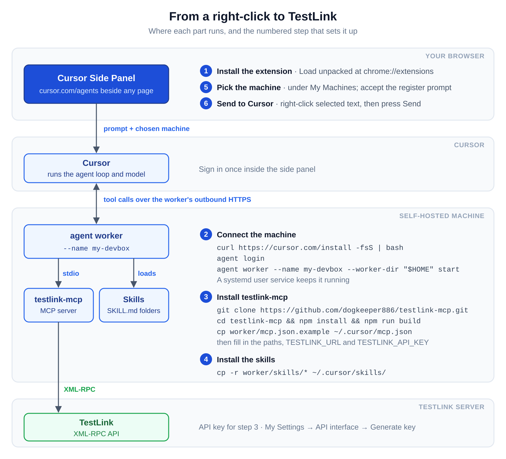

# Cursor Side Panel

Cursor's agents web app, `cursor.com/agents`, runs your coding agents from a browser tab. Cursor's pages refuse to load in a frame, and an extension shows a site in Chrome's side panel through a frame. So Cursor takes a tab of its own, and to ask about the page you read, you switch tabs and copy and paste.

Cursor Side Panel opens `cursor.com/agents` in Chrome's side panel, beside any page, and sends the text you select to Cursor's prompt box from the right-click menu.

## The side panel

Click the toolbar icon to open Cursor beside the page you read. You sign in once inside the panel, and Cursor's agents list, agent pages and prompt box work there as they do in a tab.

To install the extension in Chrome 116 or later:

1. Clone this repository, or download a release zip and unzip it.
2. Open `chrome://extensions`, turn on **Developer mode**, click **Load unpacked**, and choose the folder.
3. Pin **Cursor Side Panel** from the puzzle-piece menu, then click its icon.

While the extension installs, a tab opens, builds the right-click menu from the [menu folder](#the-menu-folder), and closes.

## Send to Cursor

Select text on a page, right-click, and choose an item under **Send to Cursor**. The side panel opens with the item's text in Cursor's prompt box, and you press **Send** yourself.

| Item | Fills the prompt box with |
| --- | --- |
| Selected text | The selection, then `Source:` and the page's address |
| Study phrasing | `/studying-phrasing` and the selection |
| Review Testlink Case | `/review-testlink-case` and the selection |

- The slash-command items run skills, which the agent's machine needs; **Review Testlink Case** needs testlink-mcp as well. [The self-hosted machine](#the-self-hosted-machine) sets both up.
- Text already in the prompt box stays, and the new text starts on a new line.
- The panel waits up to 10 seconds for a prompt box. If the wait times out, on Cursor's sign-in page for instance, the panel offers a **Copy text** button, and you paste the text yourself.

## The self-hosted machine

A Cursor agent runs its tools on one of Cursor's machines by default. **Review Testlink Case** asks the agent to read a test case from TestLink, and your TestLink server sits on your own network, beyond the reach of Cursor's machines. A My Machines worker connects a machine on your network to Cursor, so the agent's tools, MCP servers and skills run there. The `worker/` folder holds what that machine needs: an MCP config for testlink-mcp and the two skills.



### Connect the machine

On the machine, install the Cursor CLI, sign in, and start a worker:

```sh
curl https://cursor.com/install -fsS | bash
agent login
agent worker --name my-devbox --worker-dir "$HOME" start
```

`--name` names the machine in Cursor's menus, and `--worker-dir` sets the folder the agent works in. The worker serves agents only while it runs, so a systemd user service keeps it up across reboots:

```ini
# ~/.config/systemd/user/cursor-agent-worker.service
[Unit]
Description=Cursor self-hosted agent worker
After=network-online.target
Wants=network-online.target

[Service]
ExecStart=%h/.local/bin/agent worker --name my-devbox --worker-dir %h start
Restart=always
RestartSec=10s

[Install]
WantedBy=default.target
```

```sh
systemctl --user enable --now cursor-agent-worker
sudo loginctl enable-linger "$USER"
```

### Install testlink-mcp

[testlink-mcp](https://github.com/dogkeeper886/testlink-mcp) lets the agent read and write TestLink's test cases, suites, plans and executions. Build it on the machine:

```sh
git clone https://github.com/dogkeeper886/testlink-mcp.git
cd testlink-mcp
npm install
npm run build
```

The worker reads its MCP servers from `~/.cursor/mcp.json` on the machine. Copy `worker/mcp.json.example` there, or merge its `testlink` entry into the file you have. Then set the `node` and `dist/index.js` paths, `TESTLINK_URL` and `TESTLINK_API_KEY`. The worker runs testlink-mcp on the machine, so the server reaches your TestLink. The next agent you run on the machine pops up a prompt to register the server; accept it.

### Install the skills

The worker reads skills from `~/.cursor/skills/` on the machine. From a clone of this repository there, copy the two skills in:

```sh
mkdir -p ~/.cursor/skills
cp -r worker/skills/* ~/.cursor/skills/
```

`studying-phrasing` comes from [agent-workflows](https://github.com/dogkeeper886/agent-workflows), and `review-testlink-case` reviews a test case it reads through testlink-mcp.

### Pick the machine

In the side panel, start an agent. In the menu that sets where the agent runs, pick your machine under **My Machines** by its `--name`, then send your task. The agent works in the worker's folder, with testlink-mcp and the skills at hand.

## The menu folder

Send to Cursor ships with three items. Your work calls for prompts of your own. The right-click menu comes from the `menu/` folder, so you add a prompt by adding a file.

```
menu/
└── Send to Cursor/
    ├── 1 Selected text.md
    ├── 2 Study phrasing.md
    └── 3 Review Testlink Case.md
```

- A folder is a submenu, and a `.md` file is an item.
- A number and a space before a name set the order and stay out of the title: `2 Study phrasing.md` shows as **Study phrasing**.
- In a file's text, `{{query}}` stands for the selected text and `{{url}}` for the page's address. `1 Selected text.md` holds:

  ```
  {{query}}

  Source: {{url}}
  ```

Each click reads its file afresh, so the next click sends a file's new text. After you add, rename or delete a file, reload the extension: click the reload icon on its card at `chrome://extensions`.

Only an extension page can list the extension's folders, so the extension builds the menu in a background tab that closes when done. The tab flashes each time the extension installs or reloads and each time Chrome updates. With every Chrome window closed, it opens a window of its own.

## The header rule

Cursor's pages and its sign-in pages block frames through `X-Frame-Options` and the CSP `frame-ancestors` rule. A rule that removed those headers everywhere would strip Cursor's protection from every tab. The session rule in `background.js` removes both headers only from frames outside tabs, so Cursor in a normal tab keeps its protection.

- The rule covers `cursor.com`, `cursor.sh` and `workos.com`, Cursor's sign-in provider.
- The rule removes the whole `Content-Security-Policy` header, so Cursor's pages in the panel **lose all their CSP rules**, `frame-ancestors` among them.

## Files

| File | Role |
| --- | --- |
| `manifest.json` | Asks for the `sidePanel`, `declarativeNetRequest`, `storage` and `contextMenus` permissions |
| `background.js` | Adds the header rule, opens the menu builder, and turns a menu click into text for the panel |
| `panel.html`, `panel.js` | Frame `cursor.com/agents`, hand the text to the bridge, and offer Copy text |
| `cursor-bridge.js` | Pastes the text into Cursor's prompt box |
| `menu-builder.html`, `menu-builder.js` | Build the right-click menu from `menu/` |
| `worker/` | Holds the MCP config example and the skills for the self-hosted machine |
| `docs/diagrams/` | Holds the setup diagram: edit `setup.svg`, then render `setup.png` with `rsvg-convert -z 2 setup.svg -o setup.png` |

`cursor-bridge.js` runs in Cursor's pages and acts only inside this panel. Cursor's prompt box is a Lexical editor, which ignores a value set from script, so the bridge pastes the text in.

## Limits

This extension is an experiment: it depends on Cursor's headers, sign-in and prompt box as they stand today, and a change to any of them can break it. The menu builder relies on `chrome.runtime.getPackageDirectoryEntry`, an API from Chrome Apps; if Chrome drops it, the menu comes up empty.

Cursor Side Panel is independent of Cursor and Anysphere.
